# DNS Server

## 1. Overview

DNS (Domain Name System) memetakan nama domain ke alamat IP (forward lookup) dan sebaliknya (reverse lookup). Praktikum ini memasang BIND9 di Ubuntu Server dan membuat zona lokal untuk domain `arfakerensekalii.com`, sehingga IP server dapat diakses memakai nama domain dari klien Windows.

## 2. Lab Environment

* OS: Ubuntu Server
* Virtualization: Oracle VirtualBox
* Hostname server: `ubuntuarfa`
* IP server (host-only, interface `enp0s8`): `192.168.56.102`
* DNS server: BIND9 (`named`)
* Domain uji: `arfakerensekalii.com`
* Klien: Windows (Command Prompt dan web browser)

## 3. Installation

1. Cek IP server, lalu ping dari Command Prompt Windows. Pastikan ada balasan (*Reply*).

   ```bash
   ip a
   ```

   ```cmd
   ping 192.168.56.102
   ```

2. Ping nama domain yang akan dipakai dari Windows. Hasil yang diharapkan: *Ping request could not find host*, artinya domain belum ada di internet maupun di komputer klien.

   ```cmd
   ping arfakerensekalii.com
   ```

3. Di Ubuntu Server, login sebagai root, update paket, lalu pasang BIND9.

   ```bash
   apt update
   apt-get install bind9
   ```

4. Cek hasil instalasi. Layanan harus `active (running)`.

   ```bash
   named -v
   systemctl status named
   ```

5. Izinkan BIND9 di firewall.

   ```bash
   ufw allow bind9
   ```

## 4. Configuration

**a. Forwarders**

```bash
cd /etc/bind/
nano named.conf.options
```

Hapus tanda `//` pada blok `forwarders` dan isi dengan IP server:

```
forwarders {
        192.168.56.102;
};
```

**b. Zona forward dan reverse**

```bash
nano named.conf.local
```

Tambahkan di akhir file:

```
zone "arfakerensekalii.com" {
    type master;
    file "/etc/bind/db.arfakerensekalii1";
};

zone "56.168.192.in-addr.arpa" {
    type master;
    file "/etc/bind/db.arfakerensekalii2";
};
```

**c. Salin template file zona**

```bash
cp db.local db.arfakerensekalii1
cp db.127 db.arfakerensekalii2
ls
```

**d. Forward zone: `db.arfakerensekalii1`**

```bash
nano db.arfakerensekalii1
```

```
$TTL    604800
@       IN      SOA     arfakerensekalii.com. root.arfakerensekalii.com. (
                              2         ; Serial
                         604800         ; Refresh
                          86400         ; Retry
                        2419200         ; Expire
                         604800 )       ; Negative Cache TTL
;
@       IN      NS      arfakerensekalii.com.
@       IN      A       192.168.56.102
www     IN      A       192.168.56.102
```

**e. Reverse zone: `db.arfakerensekalii2`**

```bash
nano db.arfakerensekalii2
```

```
$TTL    604800
@       IN      SOA     arfakerensekalii.com. root.arfakerensekalii.com. (
                              1         ; Serial
                         604800         ; Refresh
                          86400         ; Retry
                        2419200         ; Expire
                         604800 )       ; Negative Cache TTL
;
@       IN      NS      arfakerensekalii.com.
102     IN      PTR     arfakerensekalii.com.
```

**f. Cek sintaks.** Tidak boleh ada error, dan `named-checkzone` harus menampilkan `OK`.

```bash
named-checkconf
named-checkzone arfakerensekalii.com db.arfakerensekalii1
named-checkzone 56.168.192.in-addr.arpa db.arfakerensekalii2
```

**g. Netplan.** Tambahkan nameserver pada adapter `enp0s8`.

```bash
nano /etc/netplan/01-netconf.yaml
```

```yaml
network:
  version: 2
  renderer: networkd
  ethernets:
    enp0s8:
      dhcp4: yes
      nameservers:
        addresses:
          - 8.8.8.8
          - 192.168.56.102
```

Terapkan perubahan:

```bash
netplan apply
```

**h. Restart BIND9**

```bash
service bind9 restart
```

**i. DNS di Windows.** Di pengaturan *VirtualBox Host-Only Ethernet Adapter* (IPv4), pilih *Use the following DNS server addresses* dan isi *Preferred DNS server* dengan IP Ubuntu Server (`192.168.56.102`).

## 5. Testing

Dijalankan dari terminal Ubuntu Server (empat uji pertama) dan browser Windows.

```bash
nslookup arfakerensekalii.com
nslookup 192.168.56.102
dig arfakerensekalii.com
ping arfakerensekalii.com
```

| Uji | Hasil |
|-----|-------|
| `nslookup arfakerensekalii.com` (forward) | `Name: arfakerensekalii.com`, `Address: 192.168.56.102` |
| `nslookup 192.168.56.102` (reverse) | `102.56.168.192.in-addr.arpa name = arfakerensekalii.com.` |
| `dig arfakerensekalii.com` | `status: NOERROR`, jawaban `A 192.168.56.102` |
| `ping arfakerensekalii.com` | 4 paket terkirim, 4 diterima, 0% loss |
| Browser Windows: `http://arfakerensekalii.com` | Halaman web dari server tampil |

Uji browser memakai situs Apache dari praktikum Web Server (Unit 5), jadi Apache harus aktif.

**Fungsi perintah**

* `nslookup`: menanyakan ke DNS server untuk memetakan nama domain ke IP atau sebaliknya.
* `dig`: tool lanjutan yang menampilkan detail respons DNS (header, question, answer, query time).

## 6. Troubleshooting

**`netplan apply` gagal**

* **Gejala:** muncul peringatan izin file dan error *expected mapping (check indentation)* pada `/etc/netplan/01-netconf.yaml`.
* **Penyebab:** netplan memakai YAML, sehingga indentasi harus tepat dan tidak boleh memakai tab. Peringatan lain menunjukkan file netplan terlalu terbuka izinnya.
* **Perbaikan yang umum** (laporan tidak menunjukkan langkah perbaikannya):
  1. Rapikan indentasi sesuai contoh di bagian Configuration (dua spasi per tingkat, `- ` diikuti spasi).
  2. Batasi izin file: `chmod 600 /etc/netplan/01-netconf.yaml`.
  3. Jalankan ulang `netplan apply`.

Catatan lain:

* *Ping request could not find host* sebelum DNS dikonfigurasi adalah hasil yang diharapkan.
* Jika `nslookup` gagal, jalankan `named-checkconf` dan `named-checkzone`, lalu pastikan `service bind9 restart` sudah dijalankan.

## 7. Screenshots

### Instalasi

| Langkah | Bukti |
|---------|-------|
| `ip a` | 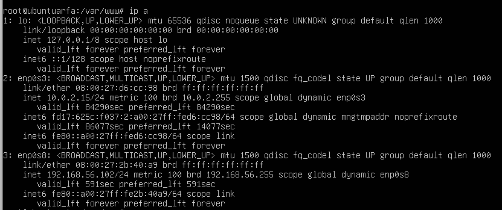 |
| Ping IP server | 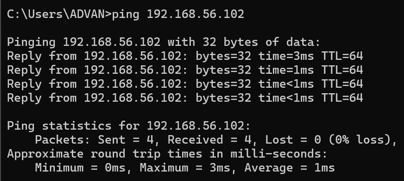 |
| Ping domain (belum dikenal) | 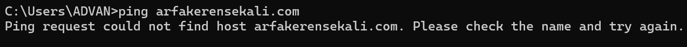 |
| `apt-get install bind9` | 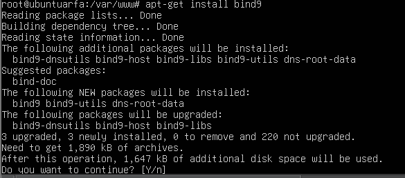 |
| `named -v` dan status | 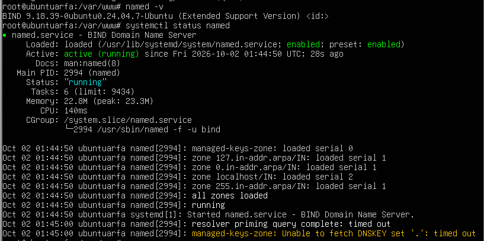 |
| `ufw allow bind9` | 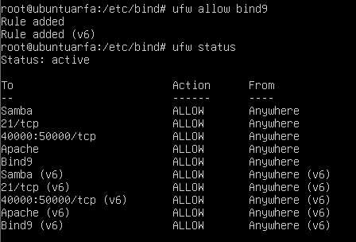 |

### Konfigurasi

| Langkah | Bukti |
|---------|-------|
| Buka `named.conf.options` | 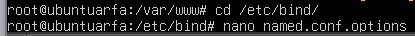 |
| Forwarders | 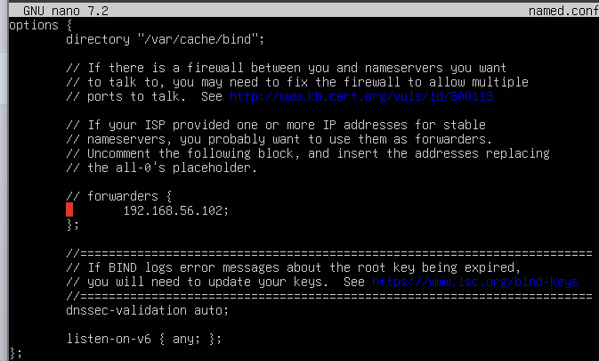 |
| Buka `named.conf.local` | 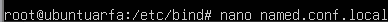 |
| Zona forward dan reverse | 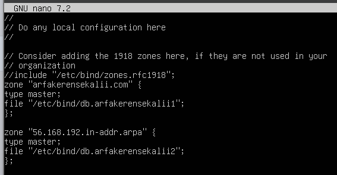 |
| Salin template file zona | 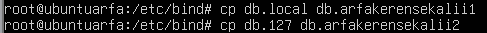 |
| Hasil salinan (`ls`) | 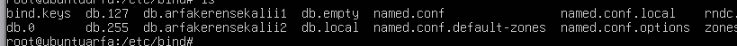 |
| Forward zone | 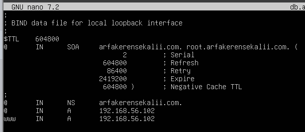 |
| Reverse zone | 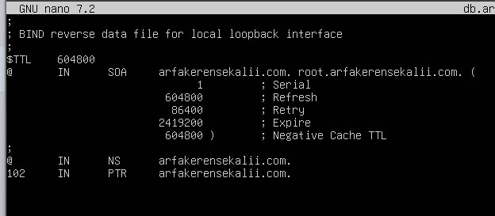 |
| `named-checkconf` dan `named-checkzone` | 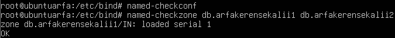 |
| Netplan: nameserver | 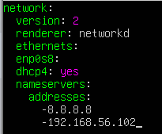 |
| `netplan apply` (error) | 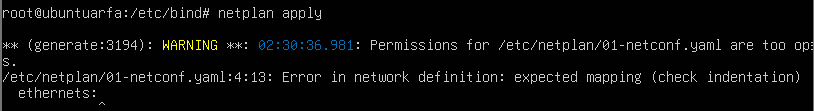 |
| Restart BIND9 | 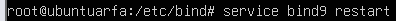 |
| DNS di Windows | 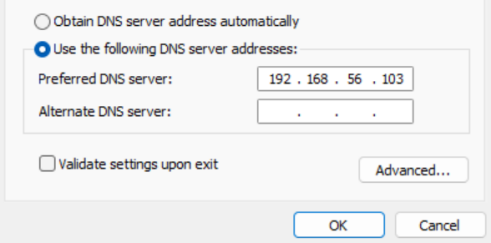 |

### Pengujian

| Uji | Bukti |
|-----|-------|
| `nslookup` domain | 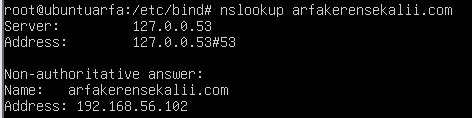 |
| `nslookup` reverse | 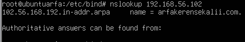 |
| `dig` | 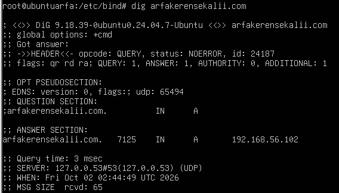 |
| `ping` domain | 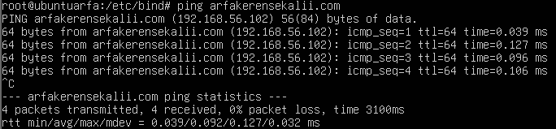 |
| Browser Windows | 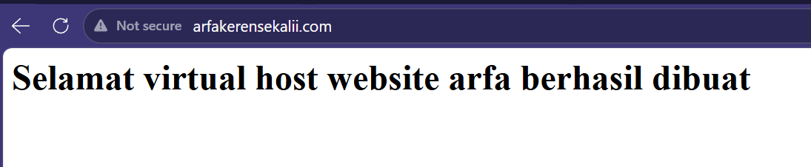 |
