# FTP Server

## 1. Overview

FTP (File Transfer Protocol) adalah protokol standar untuk memindahkan file antara server dan klien. Praktikum ini memasang FTP server `vsftpd` di Ubuntu Server, membuat user FTP, mengatur port mode pasif, memblokir user, dan memberi izin tulis, lalu mengujinya dari klien Windows.

## 2. Lab Environment

* OS: Ubuntu Server
* Virtualization: Oracle VirtualBox
* Hostname server: `ubuntuarfa`
* IP server: `192.168.56.102`
* Layanan FTP: `vsftpd`
* Klien: Windows (File Explorer)

## 3. Installation

1. Masuk sebagai root.

   ```bash
   sudo -i
   ```

2. Update paket.

   ```bash
   apt update
   ```

3. Pasang `vsftpd` dan lanjutkan prosesnya sampai selesai.

   ```bash
   apt install vsftpd
   ```

4. Cek status layanan. Hasil yang diharapkan: `active (running)`.

   ```bash
   systemctl status vsftpd
   ```

5. Cek firewall, lalu izinkan layanan FTP.

   ```bash
   ufw status
   ufw allow ftp
   ```

## 4. Configuration

**a. Port data mode pasif**

Izinkan rentang port data di firewall, lalu muat ulang aturan UFW.

```bash
ufw allow 40000:50000/tcp
ufw reload
```

Buka `/etc/vsftpd.conf`:

```bash
nano /etc/vsftpd.conf
```

Tambahkan di bagian paling bawah file:

```ini
pasv_enable=YES
pasv_min_port=40000
pasv_max_port=50000
```

Simpan, lalu restart layanan:

```bash
systemctl restart vsftpd
```

**b. Buat user FTP**

Password diisi, sedangkan data lain (Full Name, Room Number, dst.) dilewati dengan `Enter`. Direktori `/home/arfaftp` dibuat otomatis dan menjadi folder FTP user tersebut.

```bash
adduser arfaftp
systemctl restart vsftpd
```

**c. Siapkan isi folder FTP**

```bash
cd /home
ls
mkdir /home/arfaftp/folder_baru
touch /home/arfaftp/file_baru
```

**d. Blokir user (opsional, untuk uji pembatasan akses)**

Tambahkan nama user di baris paling bawah `/etc/ftpusers`:

```bash
nano /etc/ftpusers
```

```
arfaftp
```

Untuk membuka blokir, hapus kembali baris `arfaftp` dari file tersebut.

**e. Beri izin tulis**

Cadangkan konfigurasi, lalu buka dengan nomor baris:

```bash
cp /etc/vsftpd.conf /etc/vsftpd.conf.backup
nano /etc/vsftpd.conf --linenumbers
```

Hapus tanda komentar pada baris 31 sehingga menjadi:

```ini
write_enable=YES
```

Simpan, lalu restart layanan:

```bash
systemctl restart vsftpd
```

## 5. Testing

1. **Login FTP.** Di Windows, buka File Explorer dan ketik `ftp://192.168.56.102` di address bar. Jendela *Log On As* harus muncul. Login dengan user `arfaftp`. Login berhasil, tetapi folder masih kosong sebelum file dibuat.
2. **Isi folder.** Setelah `folder_baru` dan `file_baru` dibuat di server, refresh File Explorer. Keduanya muncul di sisi klien.
3. **Blokir user.** Setelah `arfaftp` ditambahkan ke `/etc/ftpusers`, tutup File Explorer, buka lagi, lalu login dengan `arfaftp`. Login gagal (*Could not login to the FTP server with the user name and password specified*). Setelah pengujian, hapus `arfaftp` dari `/etc/ftpusers`.
4. **Tulis sebelum `write_enable=YES`.** Membuat atau menghapus file dari File Explorer gagal dengan `550 Permission denied`.
5. **Tulis sesudah `write_enable=YES`.** Salin file dari komputer lokal ke folder FTP dan sebaliknya. Keduanya berhasil.

| Pengujian | Hasil |
|-----------|-------|
| Login `arfaftp` | Berhasil |
| Folder dan file terlihat di klien | Berhasil |
| Login setelah user diblokir | Gagal (sesuai harapan) |
| Tulis file sebelum `write_enable=YES` | Gagal, `550 Permission denied` |
| Copy file dua arah setelah `write_enable=YES` | Berhasil |

## 6. Troubleshooting

Tidak ada kendala yang tercatat selama praktikum. Panduan di laporan jika login FTP gagal karena akses tidak diizinkan:

* **Gejala:** login dari Windows gagal padahal user dan password benar.
* **Penyelesaian:**
  1. Pastikan aturan firewall sudah ada: `ufw allow ftp` dan `ufw allow 40000:50000/tcp`, lalu `ufw reload`.
  2. Jika masih gagal, nonaktifkan firewall untuk sementara: `ufw disable`. Langkah ini hanya untuk pengujian di lab.

Catatan lain:

* `550 Permission denied` saat membuat atau menghapus file sebelum `write_enable=YES` diaktifkan adalah perilaku default, bukan error.
* Pastikan `pasv_min_port` dan `pasv_max_port` di `vsftpd.conf` sama dengan rentang port yang dibuka di UFW.

## 7. Screenshots

### Instalasi

| Langkah | Bukti |
|---------|-------|
| Login root | 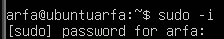 |
| `apt update` |  |
| `apt install vsftpd` | 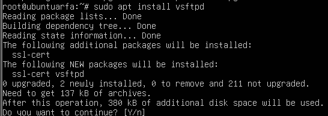 |
| Status `vsftpd` aktif | 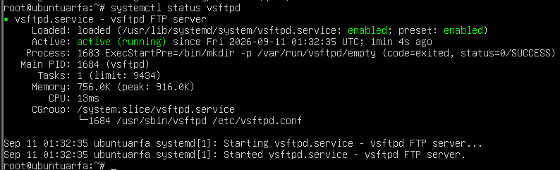 |
| `ufw status` | 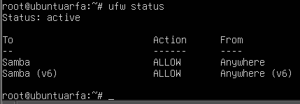 |
| `ufw allow ftp` | 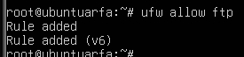 |

### Konfigurasi

| Langkah | Bukti |
|---------|-------|
| `ufw allow 40000:50000/tcp` | 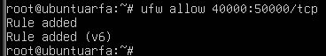 |
| `ufw reload` | 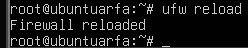 |
| Buka `vsftpd.conf` | 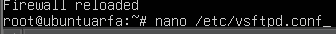 |
| Konfigurasi pasif | 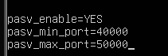 |
| Restart `vsftpd` |  |
| `adduser arfaftp` | 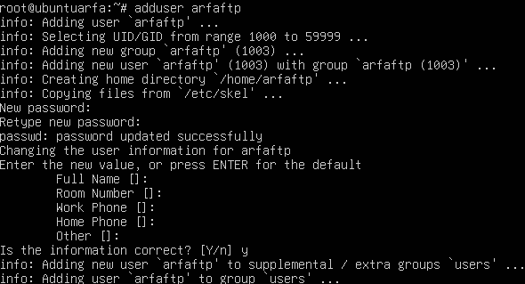 |
| Restart setelah user dibuat | 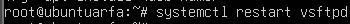 |
| `ls` di `/home` |  |
| `mkdir` dan `touch` | 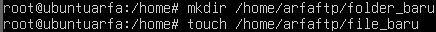 |
| Buka `/etc/ftpusers` |  |
| `arfaftp` ditambahkan ke `ftpusers` | 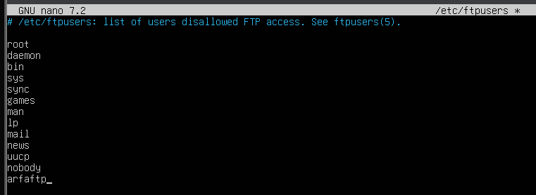 |
| Backup `vsftpd.conf` |  |
| Buka dengan `--linenumbers` |  |
| `write_enable=YES` | 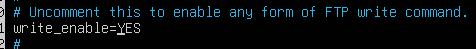 |
| Restart setelah `write_enable` |  |

### Pengujian

| Uji | Bukti |
|-----|-------|
| Jendela login FTP | 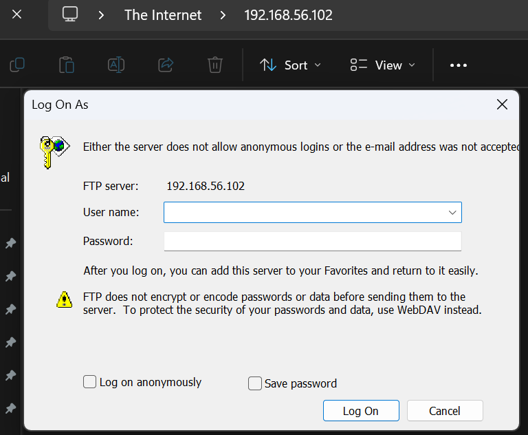 |
| Folder dan file terlihat di klien | 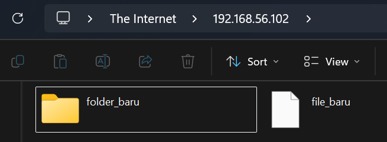 |
| Login gagal (user diblokir) | 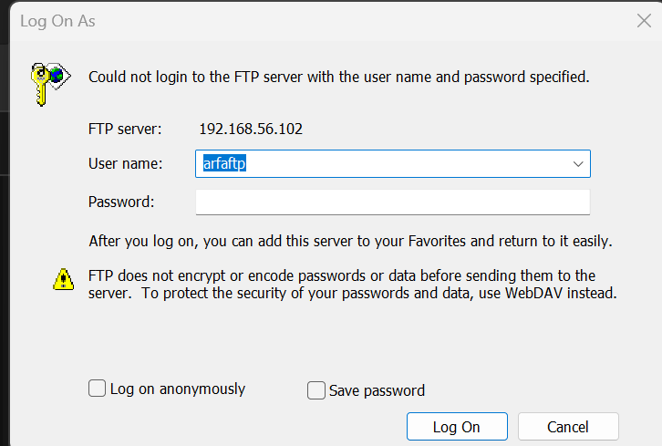 |
| Tulis ditolak sebelum `write_enable` | 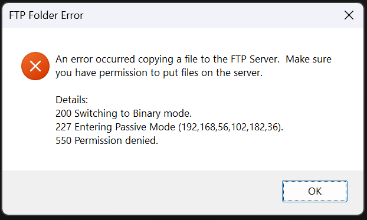 |
| Copy file ke folder FTP | 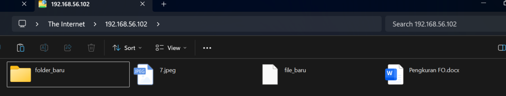 |
| Copy file dari FTP ke lokal | 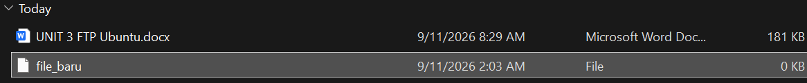 |
