# Mail Server

## 1. Overview

Mail server menerima, menyimpan, dan mengirim email lewat jaringan. Praktikum ini memasang **Postfix** (MTA, protokol SMTP) dan **Dovecot** (akses email lewat IMAP/POP3) di Ubuntu Server. Setelah konfigurasi, dibuat satu user tambahan untuk mengirim email ke user awal, lalu akses email diuji lewat IMAP (telnet) dan perintah `mail`.

## 2. Lab Environment

* OS: Ubuntu Server
* Virtualization: Oracle VirtualBox
* Hostname server: `ubuntuarfa`
* IP server: `192.168.56.102`
* Mail server: Postfix (SMTP) dan Dovecot (IMAP/POP3)
* Format mailbox: Maildir
* User: `arfa` (user awal, penerima) dan `ubuntu` (user baru, pengirim)

## 3. Installation

1. Masuk sebagai root, lalu update paket.

   ```bash
   sudo su
   apt update
   ```

2. Pasang Postfix, Dovecot, dan utilitas pendukung. Pada jendela *Postfix Configuration*, pilih **No configuration**.

   ```bash
   apt -y install postfix sasl2-bin dovecot-core dovecot-pop3d dovecot-imapd mailutils
   ```

3. Salin template konfigurasi Postfix.

   ```bash
   cp /usr/share/postfix/main.cf.dist /etc/postfix/main.cf
   ```

## 4. Configuration

### a. Postfix: `/etc/postfix/main.cf`

```bash
nano /etc/postfix/main.cf --linenumbers
```

Ubah baris berikut (nomor baris sesuai template):

| Baris | Pengaturan |
|-------|-----------|
| 82 | `mail_owner = postfix` (uncomment) |
| 98 | `myhostname = mail.example.com` (uncomment) |
| 106 | `mydomain = example.com` (uncomment) |
| 127 | `myorigin = $mydomain` (uncomment) |
| 141 | `inet_interfaces = all` (uncomment) |
| 189 | `mydestination = $myhostname, localhost.$mydomain, localhost, $mydomain` (uncomment) |
| 232 | `local_recipient_maps = unix:passwd.byname $alias_maps` (uncomment) |
| 277 | `mynetworks_style = subnet` (uncomment) |
| 294 | `mynetworks = 127.0.0.0/8, 192.168.56.102/24` (tambahkan) |
| 416 | `alias_maps = hash:/etc/aliases` (uncomment) |
| 427 | `alias_database = hash:/etc/aliases` (uncomment) |
| 449 | `home_mailbox = Maildir/` (uncomment) |
| 585-586 | Komentari `smtpd_banner` lama, lalu tulis `smtpd_banner = $myhostname ESMTP` di baris 586 |
| 659 | `sendmail_path = /usr/sbin/postfix` |
| 664 | `newaliases_path = /usr/bin/newaliases` |
| 669 | `mailq_path = /usr/bin/mailq` |
| 675 | `setgid_group = postdrop` |
| 679 | `#html_directory =` (komentari) |
| 683 | `#manpage_directory =` (komentari) |
| 688 | `#sample_directory =` (komentari) |
| 692 | `#readme_directory =` (komentari) |
| 693 | `inet_protocols = ipv4` (biarkan default) |

Tambahkan di akhir file (batas ukuran email dan autentikasi SMTP lewat Dovecot):

```ini
message_size_limit = 10485760
mailbox_size_limit = 1073741824

# SMTP-Auth settings
smtpd_sasl_type = dovecot
smtpd_sasl_path = private/auth
smtpd_sasl_auth_enable = yes
smtpd_sasl_security_options = noanonymous
smtpd_sasl_local_domain = $myhostname
smtpd_recipient_restrictions = permit_mynetworks, permit_auth_destination, permit_sasl_authenticated, reject
```

Simpan, lalu perbarui database alias:

```bash
newaliases
```

### b. Dovecot: `dovecot.conf`

```bash
nano /etc/dovecot/dovecot.conf --linenumbers
```

Baris 30 (uncomment):

```ini
listen = *, ::
```

### c. Dovecot: `10-auth.conf`

```bash
nano /etc/dovecot/conf.d/10-auth.conf --linenumbers
```

```ini
disable_plaintext_auth = no     # baris 10
auth_mechanisms = plain login   # baris 100
```

### d. Dovecot: `10-mail.conf`

```bash
nano /etc/dovecot/conf.d/10-mail.conf --linenumbers
```

Baris 30:

```ini
mail_location = maildir:~/Maildir
```

### e. Dovecot: `10-master.conf`

```bash
nano /etc/dovecot/conf.d/10-master.conf --linenumbers
```

Baris 109-113 (uncomment dan tambahkan `user` dan `group`):

```
# Postfix smtp-auth
unix_listener /var/spool/postfix/private/auth {
  mode = 0666
  user = postfix
  group = postfix
}
```

### f. Restart dan cek layanan

```bash
systemctl restart dovecot postfix ; systemctl status dovecot postfix
```

Hasil yang diharapkan: `dovecot` berstatus `active (running)` dan `postfix` berstatus `active (exited)`.

### g. Tambah akun user

Atur variabel `MAIL` untuk Maildir, lalu buat user baru dan reboot.

```bash
echo 'export MAIL=$HOME/Maildir/' >> /etc/profile.d/mail.sh
adduser ubuntu
reboot
```

Isi password, lalu kosongkan Full Name, Room Number, dan seterusnya dengan menekan `Enter`.

## 5. Testing

### a. Kirim email antar user

1. Dari user `ubuntu`, kirim email ke user awal `arfa`.

   ```bash
   su ubuntu
   mail arfa@localhost
   ```

   Kosongkan Cc dengan `Enter`, isi subjek dan isi pesan, lalu akhiri dengan `Ctrl+D`.

   ```
   Subject: Uji coba email 1
   ini adalah uji coba email pertama.
   terimakasih
   ```

2. Keluar dan masuk ke user `arfa` (`exit`). Muncul notifikasi *You have new mail in /home/arfa/Maildir/*.

### b. Akses email lewat IMAP (Dovecot)

```bash
systemctl is-active dovecot
apt install -y telnet
telnet localhost 143
```

Di dalam sesi telnet (ganti `<password>` dengan password user `arfa`):

```
a1 LOGIN "arfa" "<password>"
a2 SELECT INBOX
a3 FETCH 1 BODY.PEEK[TEXT]
a4 LOGOUT
```

| Perintah | Hasil |
|----------|-------|
| `systemctl is-active dovecot` | `active` |
| `telnet localhost 143` | `* OK ... Dovecot ready.` |
| `a1 LOGIN` | `a1 OK ... Logged in.` |
| `a2 SELECT INBOX` | `* 2 EXISTS`, `a2 OK [READ-WRITE] Select completed.` |
| `a3 FETCH 1 BODY.PEEK[TEXT]` | Isi email pertama tampil, `a3 OK Fetch completed.` |
| `a4 LOGOUT` | `* BYE Logging out`, `a4 OK Logout completed.` |

### c. Baca email dengan `mail`

```bash
mail
```

Ketik nomor email (misalnya `1`) untuk membuka isinya, lalu `q` dan `Enter` untuk keluar. Daftar menampilkan dua pesan dari `ubuntu@ubuntuarfa`, dan isi email pertama tampil sesuai yang dikirim.

## 6. Troubleshooting

Tidak ada kendala besar yang tercatat di laporan. Dua hal kecil yang terlihat di screenshot:

* **Password `adduser` kosong pada percobaan pertama:** muncul pesan *No password has been supplied*. Penyelesaian: ulangi pengisian password hingga muncul *password updated successfully*.
* **`FETCH` pertama sempat error:** di bagian atas screenshot `FETCH` terlihat pesan `BAD Error in IMAP command FETCH: Invalid arguments`. Perintah lalu diulang dan berhasil. Penyebab yang umum adalah salah ketik sintaks, jadi pastikan perintahnya tepat `a3 FETCH 1 BODY.PEEK[TEXT]`.

Catatan lain:

* Jika Dovecot atau Postfix gagal berjalan, cek penulisan parameter di `main.cf` dan file konfigurasi Dovecot, lalu lihat log dengan `journalctl -u dovecot -u postfix`.
* Status `active (exited)` pada Postfix adalah normal.
* `disable_plaintext_auth = no` dan `auth_mechanisms = plain login` hanya untuk lab tanpa SSL/TLS. Di lingkungan nyata, aktifkan enkripsi.

## 7. Screenshots

### Instalasi

| Langkah | Bukti |
|---------|-------|
| `sudo su` | 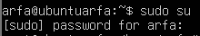 |
| `apt update` | 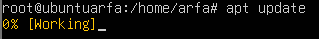 |
| Pasang Postfix dan Dovecot | 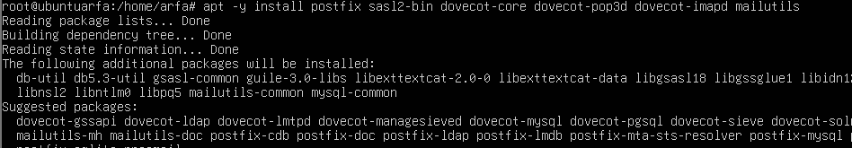 |
| Jendela Postfix Configuration | 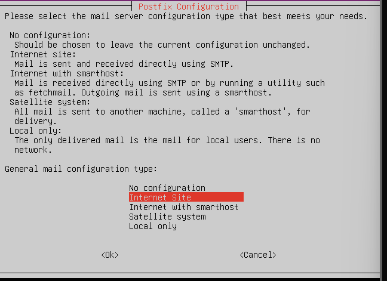 |
| Salin `main.cf` | 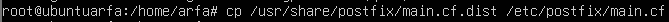 |

### Konfigurasi Postfix

| Langkah | Bukti |
|---------|-------|
| Buka `main.cf` | 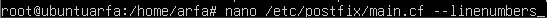 |
| `mail_owner` | 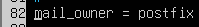 |
| `myhostname` |  |
| `mydomain` | 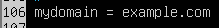 |
| `myorigin` | 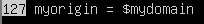 |
| `inet_interfaces` | 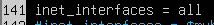 |
| `mydestination` | 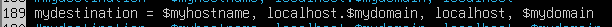 |
| `local_recipient_maps` | 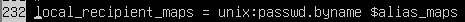 |
| `mynetworks_style` | 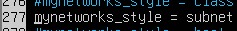 |
| `mynetworks` | 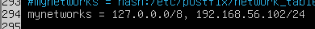 |
| `alias_maps` | 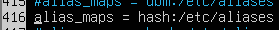 |
| `alias_database` | 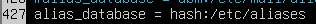 |
| `home_mailbox` | 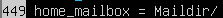 |
| `smtpd_banner` | 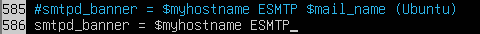 |
| `sendmail_path` |  |
| `newaliases_path` | 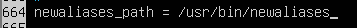 |
| `mailq_path` | 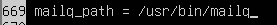 |
| `setgid_group` | 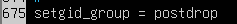 |
| `html_directory` | 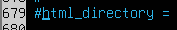 |
| `manpage_directory` |  |
| `sample_directory` | 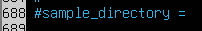 |
| `readme_directory` |  |
| `inet_protocols` |  |
| Batas ukuran dan SMTP-Auth | 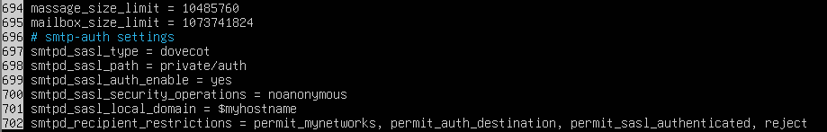 |
| `newaliases` | 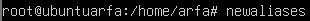 |

### Konfigurasi Dovecot

| Langkah | Bukti |
|---------|-------|
| Buka `dovecot.conf` | 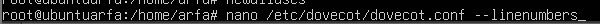 |
| `listen` | 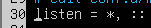 |
| Buka `10-auth.conf` | 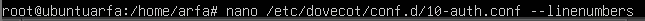 |
| `disable_plaintext_auth` | 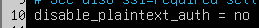 |
| `auth_mechanisms` | 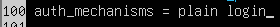 |
| Buka `10-mail.conf` | 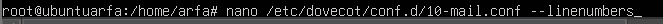 |
| `mail_location` | 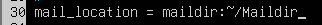 |
| Buka `10-master.conf` |  |
| `unix_listener` | 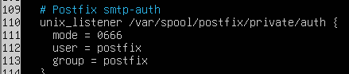 |
| Restart Dovecot dan Postfix | 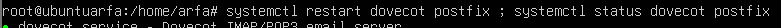 |
| Status Dovecot dan Postfix | 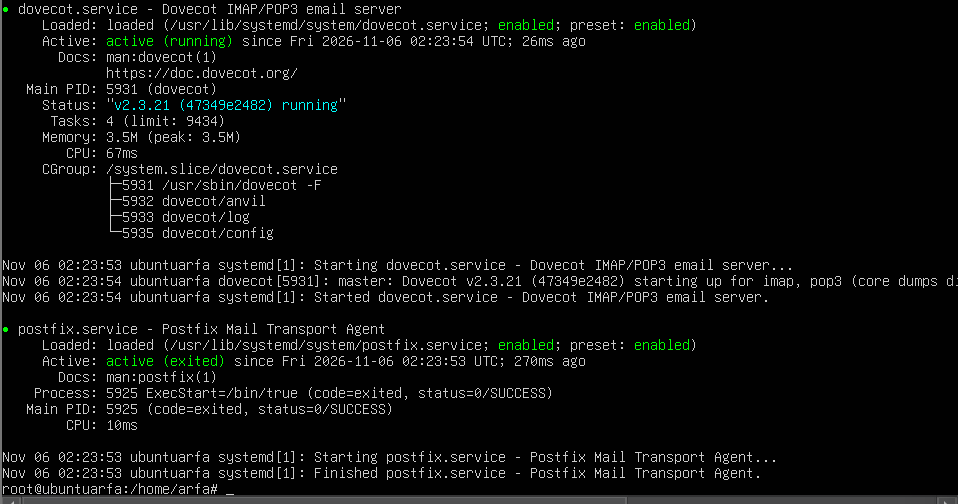 |
| Variabel `MAIL` | 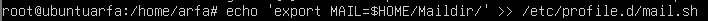 |
| `adduser ubuntu` | 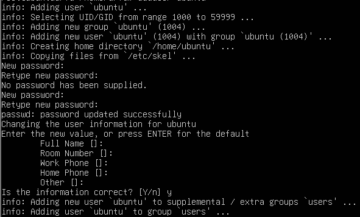 |

### Pengujian

| Uji | Bukti |
|-----|-------|
| Kirim email dari `ubuntu` | 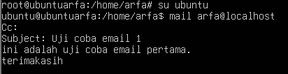 |
| Notifikasi email baru | 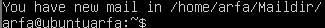 |
| Dovecot aktif | 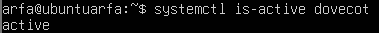 |
| Pasang telnet | 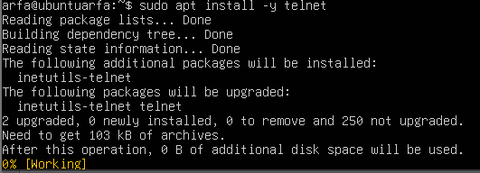 |
| `telnet localhost 143` | 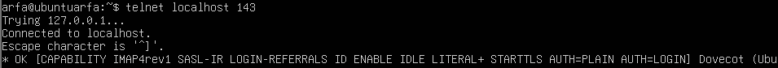 |
| Login IMAP | 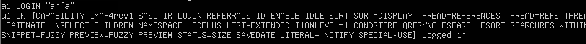 |
| `SELECT INBOX` | 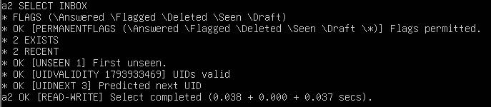 |
| `FETCH` isi email | 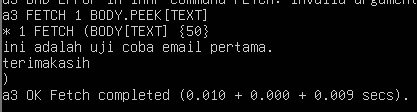 |
| `LOGOUT` | 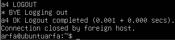 |
| Baca email dengan `mail` | 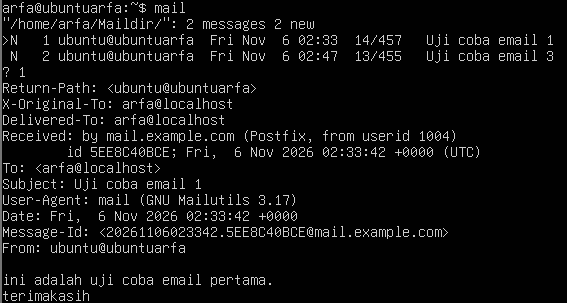 |
