# Proxy Server

## 1. Overview

Proxy server adalah perantara antara klien dan internet: permintaan klien dikirim ke proxy dulu, lalu diteruskan ke tujuan. Praktikum ini memasang Squid di Ubuntu Server, mengatur proxy di sisi klien Windows, lalu memblokir situs tertentu lewat daftar domain (ACL).

## 2. Lab Environment

* OS: Ubuntu Server
* Virtualization: Oracle VirtualBox
* Hostname server: `ubuntuarfa`
* IP server: `192.168.56.102`
* Proxy server: Squid, port `3128`
* Klien: Windows 11 dengan browser Microsoft Edge

## 3. Installation

1. Update paket.

   ```bash
   apt-get update
   ```

2. Pasang Squid.

   ```bash
   apt-get install squid
   ```

3. Cek status layanan. Hasil yang diharapkan: `active (running)`, dan log menunjukkan Squid mendengarkan di port `3128`.

   ```bash
   systemctl status squid
   ```

4. Izinkan Squid di firewall, lalu cek profilnya.

   ```bash
   ufw allow squid
   ufw app list
   ```

## 4. Configuration

**a. Backup dan cek port**

```bash
cd /etc/squid
ls
cp squid.conf squid.conf.backup
nano squid.conf --linenumbers
```

Di baris 2179 terlihat Squid memakai port default:

```
http_port 3128
```

**b. Izinkan akses klien**

Cari bagian `INSERT YOUR OWN RULE(S) HERE TO ALLOW ACCESS FROM YOUR CLIENTS` (`Ctrl+W`), lalu ubah:

```
http_access deny all
```

menjadi:

```
http_access allow all
```

Simpan, lalu restart Squid:

```bash
service squid restart
```

> `allow all` hanya untuk kebutuhan lab. Di jaringan nyata, batasi dengan ACL jaringan lokal.

**c. Blokir situs**

1. Buka `squid.conf`.

   ```bash
   nano /etc/squid/squid.conf
   ```

2. Di bagian *your own rule*, tepat di bawah baris `include /etc/squid/conf.d/*.conf`, tambahkan:

   ```
   acl bad_url dstdomain "/etc/squid/bad_url.acl"
   http_access deny bad_url
   ```

   Aturan ini harus berada sebelum `http_access allow all`, karena Squid membaca aturan dari atas ke bawah.

3. Buat daftar domain yang diblokir. Tanda titik di depan domain juga mencakup semua subdomainnya.

   ```bash
   nano /etc/squid/bad_url.acl
   ```

   ```
   .youtube.com
   .facebook.com
   ```

4. Restart Squid agar daftar dibaca.

   ```bash
   service squid restart
   ```

## 5. Testing

**Pengaturan proxy di klien (Windows 11)**

1. Buka *Settings > Network & internet > Proxy*.
2. Di *Manual proxy setup*, klik *Edit* pada *Use a proxy server*.
3. Aktifkan *Use a proxy server*, isi *Proxy IP address* `192.168.56.102` dan *Port* `3128`, lalu *Save*.

**Pengujian**

| Kondisi | Uji | Hasil |
|---------|-----|-------|
| `http_access allow all`, belum ada blokir | Buka `youtube.com` | Berhasil dibuka lewat proxy |
| Setelah `bad_url.acl` aktif | Buka `youtube.com` | Gagal, tampil *Sambungan ke internet* |
| Setelah `bad_url.acl` aktif | Buka `facebook.com` | Gagal, *Hmmm... can't reach this page* (`ERR_TUNNEL_CONNECTION_FAILED`) |

## 6. Troubleshooting

Tidak ada kendala yang tercatat selama praktikum. Hal yang perlu diperhatikan:

* **Situs masih terbuka setelah diblokir:** pastikan `acl bad_url` dan `http_access deny bad_url` berada sebelum `http_access allow all`, lalu jalankan `service squid restart`. Tutup tab browser atau bersihkan cache jika halaman lama masih tampil.
* **Klien tidak bisa membuka situs apa pun:** cek `systemctl status squid`, aturan `ufw allow squid`, serta IP dan port proxy di pengaturan klien.
* **Salah ketik di `squid.conf`:** kembalikan dari `squid.conf.backup` yang dibuat sebelum konfigurasi.

## 7. Screenshots

### Instalasi

| Langkah | Bukti |
|---------|-------|
| `apt-get update` | 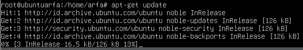 |
| `apt-get install squid` | 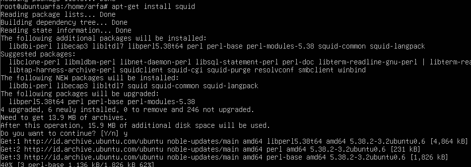 |
| Status Squid | 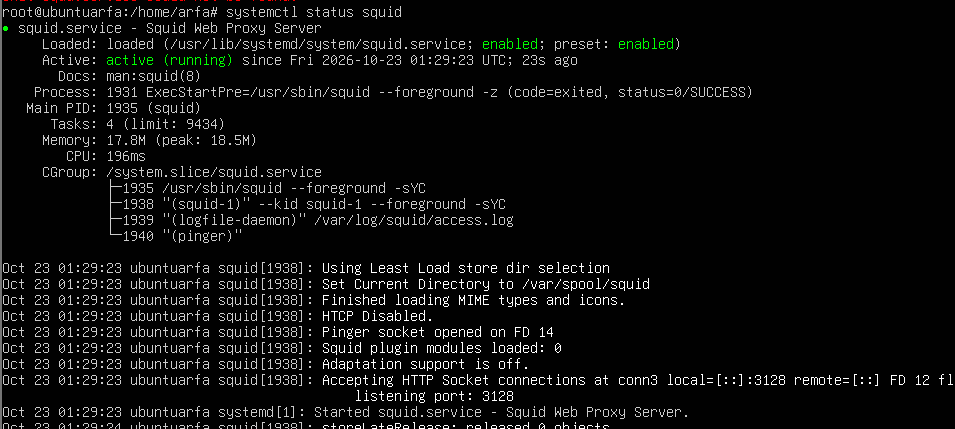 |
| `ufw allow squid` | 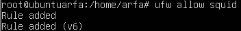 |
| `ufw app list` | 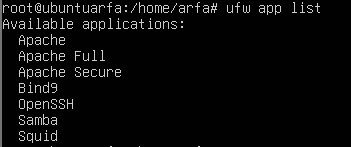 |

### Konfigurasi

| Langkah | Bukti |
|---------|-------|
| `cd /etc/squid` dan `ls` | 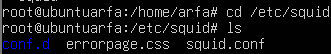 |
| Backup `squid.conf` | 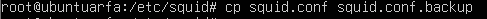 |
| `http_port 3128` | 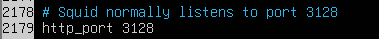 |
| `http_access allow all` | 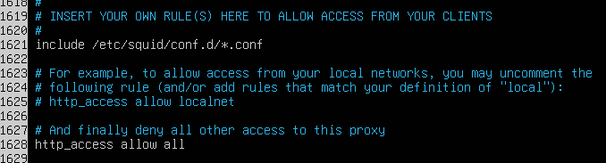 |
| Restart Squid | 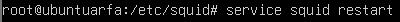 |
| Buka `squid.conf` untuk ACL | 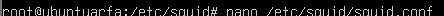 |
| ACL `bad_url` | 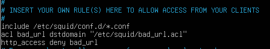 |
| Buat `bad_url.acl` | 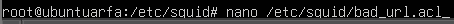 |
| Isi `bad_url.acl` | 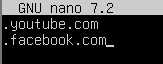 |

### Pengujian

| Uji | Bukti |
|-----|-------|
| Cari pengaturan proxy di browser | 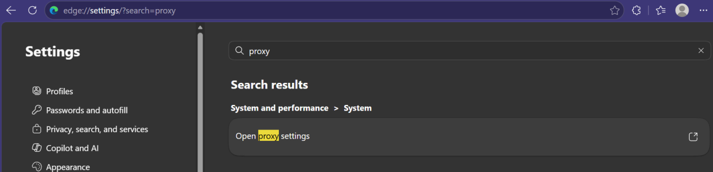 |
| Edit proxy server di Windows | 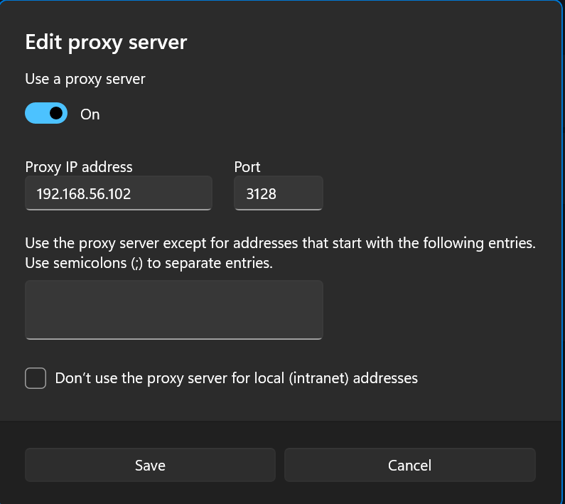 |
| YouTube terbuka (sebelum blokir) | 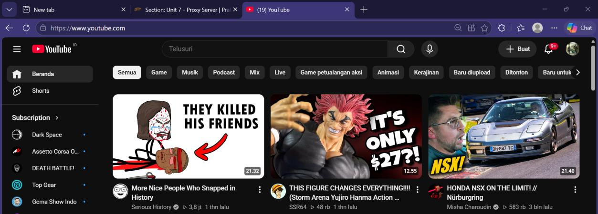 |
| YouTube diblokir | 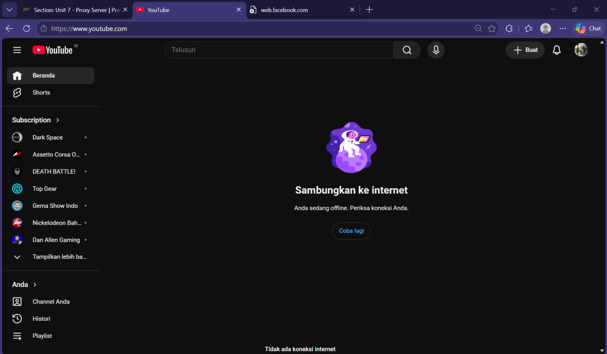 |
| Facebook diblokir | 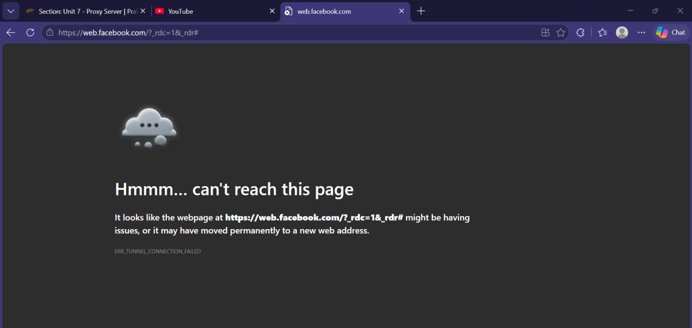 |
