# Web Server

## 1. Overview

Web server adalah program yang melayani akses ke situs web lewat protokol HTTP/HTTPS. Praktikum ini memasang Apache2 di Ubuntu Server, membuka akses firewall, mengganti document root ke folder situs sendiri (virtual hosting), lalu menambah sub folder `about`. Pengujian dilakukan dari Windows dan dari terminal Ubuntu memakai `w3m`.

## 2. Lab Environment

* OS: Ubuntu Server
* Virtualization: Oracle VirtualBox
* Hostname server: `ubuntuarfa`
* IP server (host-only, interface `enp0s8`): `192.168.56.102`
* Web server: Apache2
* Klien: Windows (Command Prompt dan web browser)

## 3. Installation

### Sebelum instalasi

1. Login sebagai root, lalu update indeks paket.

   ```bash
   apt update
   ```

2. Cek alamat IP server.

   ```bash
   ip a
   ```

3. Dari Windows, ping IP server lewat Command Prompt.

   ```cmd
   ping 192.168.56.102
   ```

   Ada balasan (0% loss), jadi kedua mesin sudah terhubung.

4. Buka `http://192.168.56.102` di browser Windows. Halaman belum bisa dibuka karena web server belum dipasang.

5. Alternatif jika ping gagal: pasang `w3m` (browser teks) dan cek dari server.

   ```bash
   apt install w3m
   w3m -v http://192.168.56.102
   ```

   Sebelum Apache dipasang, hasilnya gagal memuat halaman.

### Instalasi Apache

1. Pasang Apache2.

   ```bash
   apt install apache2
   ```

2. Cek profil Apache di firewall.

   ```bash
   ufw app list
   ```

3. Cek status firewall. Aktifkan jika `inactive`.

   ```bash
   ufw status
   ufw enable
   ```

4. Izinkan Apache (membuka port 80), lalu cek lagi.

   ```bash
   ufw allow 'Apache'
   ufw status
   ```

### Cek hasil instalasi

1. Pastikan layanan berjalan. Hasil yang diharapkan: `active (running)`.

   ```bash
   systemctl status apache2
   ```

2. Buka `http://192.168.56.102` di browser Windows, atau jalankan `w3m -v http://192.168.56.102` di server. Halaman default Apache bertuliskan **It works!** harus muncul.

## 4. Configuration

### a. Virtual hosting

1. Lihat direktori default web server.

   ```bash
   cd /var/www
   ls
   ```

2. Buat direktori untuk situs baru dan file `index.html`.

   ```bash
   mkdir /var/www/websitearfa
   nano /var/www/websitearfa/index.html
   ```

3. Isi `index.html`:

   ```html
   <html>
     <head>
       <title>Selamat datang di website arfa</title>
     </head>
     <body>
       <h1>Selamat virtual host website arfa berhasil dibuat</h1>
     </body>
   </html>
   ```

4. Ubah document root.

   ```bash
   nano /etc/apache2/sites-available/000-default.conf
   ```

   Beri komentar pada baris `DocumentRoot` lama, lalu tambahkan baris baru:

   ```apache
   #DocumentRoot /var/www/html
   DocumentRoot /var/www/websitearfa
   ```

5. Restart Apache.

   ```bash
   systemctl restart apache2
   ```

### b. Sub folder

1. Buat sub folder `about` dan file `index.html`-nya.

   ```bash
   mkdir /var/www/websitearfa/about
   nano /var/www/websitearfa/about/index.html
   ```

2. Isi `about/index.html`:

   ```html
   <html>
     <head>
       <title>About - website arfa</title>
     </head>
     <body>
       <h1>ini adalah laman deskripsi website arfa</h1>
     </body>
   </html>
   ```

## 5. Testing

| Uji | Cara | Hasil |
|-----|------|-------|
| Konektivitas | `ping 192.168.56.102` dari Windows | Berhasil, 4 paket diterima, 0% loss |
| Sebelum Apache dipasang | `http://192.168.56.102` di browser Windows | Gagal (*took too long to respond*) |
| Setelah Apache dipasang | Buka `http://192.168.56.102` atau `w3m` | Halaman **It works!** |
| Virtual host | Refresh browser atau `w3m -v http://192.168.56.102` | Tampil "Selamat virtual host website arfa berhasil dibuat" |
| Sub folder | `w3m -v http://192.168.56.102/about` | Tampil "ini adalah laman deskripsi website arfa" |
| Akses dari Windows | Buka `http://192.168.56.102` di browser Windows | Situs dapat diakses |

Untuk uji sub folder dari Windows, buka `http://192.168.56.102/about`.

## 6. Troubleshooting

Tidak ada kendala yang tercatat selama praktikum. Hal yang perlu diperhatikan:

* **Halaman gagal dibuka sebelum Apache dipasang:** ini perilaku yang diharapkan karena web server belum ada. Ping berhasil tetapi browser timeout.
* **Browser Windows timeout setelah Apache dipasang:** cek `ufw status` dan pastikan aturan `Apache` aktif (`ufw allow 'Apache'`), serta layanan `apache2` berstatus `active (running)`.
* **Ping dari Windows gagal:** cek IP server dengan `ip a`, lalu uji dari server memakai `w3m -v http://<IP-server>`.
* **Perubahan `DocumentRoot` tidak terlihat:** pastikan `systemctl restart apache2` sudah dijalankan dan refresh browser.

## 7. Screenshots

### Sebelum instalasi

| Langkah | Bukti |
|---------|-------|
| `apt update` | 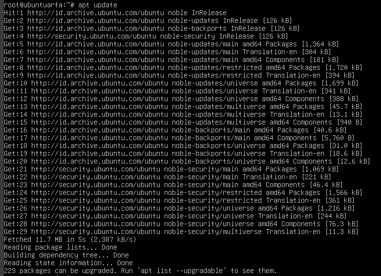 |
| `ip a` | 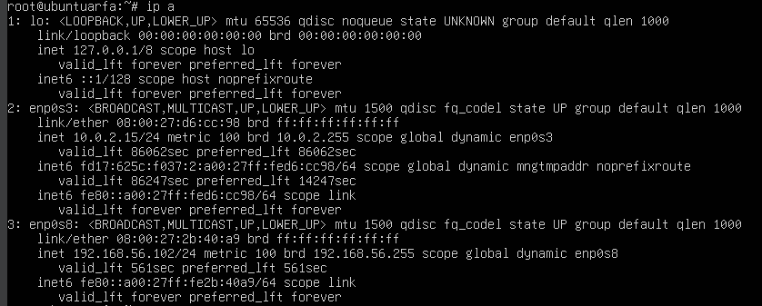 |
| Ping dari Windows | 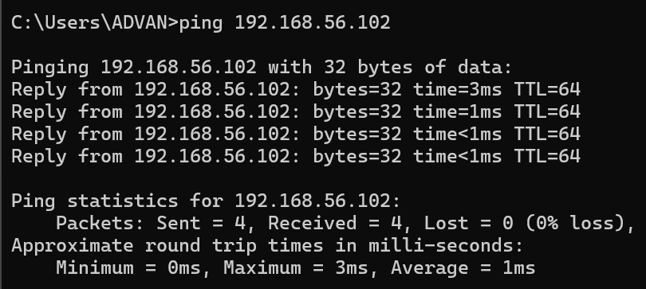 |
| Browser Windows sebelum instalasi | 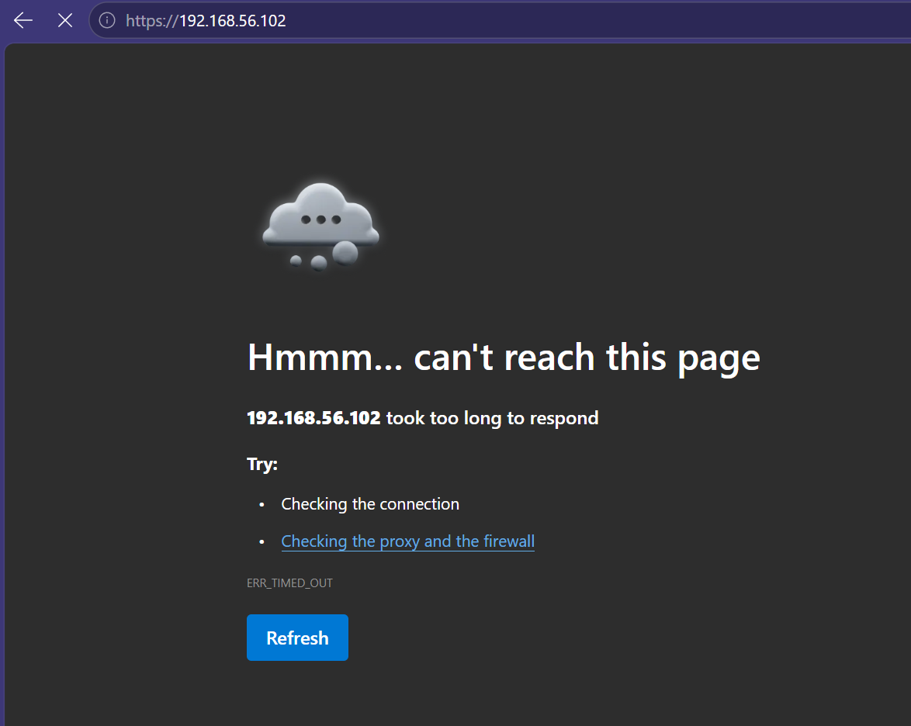 |
| `w3m` sebelum instalasi | 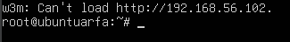 |

### Instalasi

| Langkah | Bukti |
|---------|-------|
| `apt install apache2` | 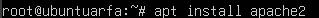 |
| `ufw app list` | 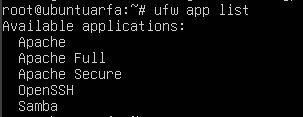 |
| `ufw status` sebelum Apache diizinkan | 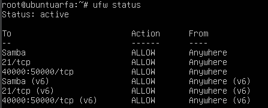 |
| `ufw allow 'Apache'` | 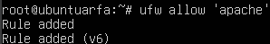 |
| Status `apache2` aktif | 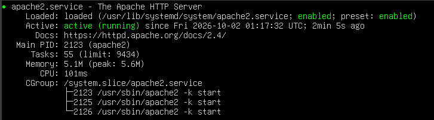 |
| Halaman default **It works!** | 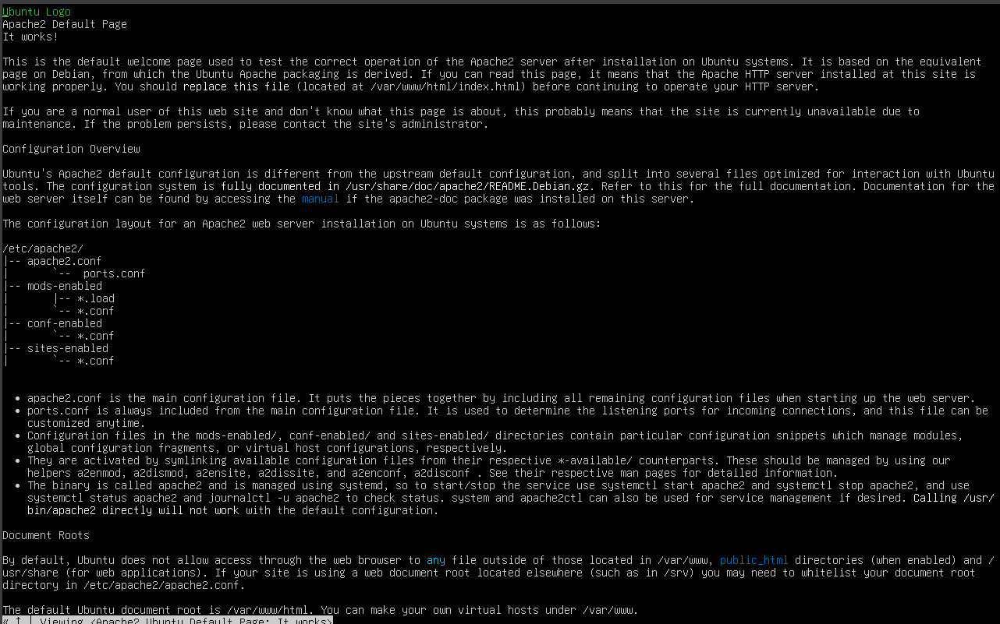 |

### Konfigurasi

| Langkah | Bukti |
|---------|-------|
| `cd /var/www` dan `ls` | 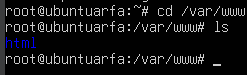 |
| `mkdir websitearfa` | 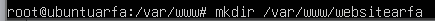 |
| Buat `index.html` | 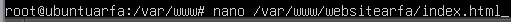 |
| Isi `index.html` | 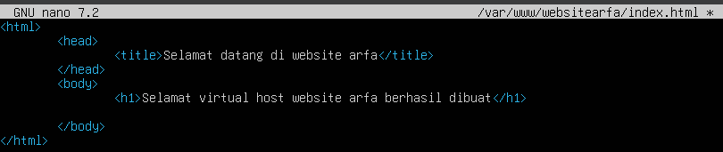 |
| Ubah `DocumentRoot` | 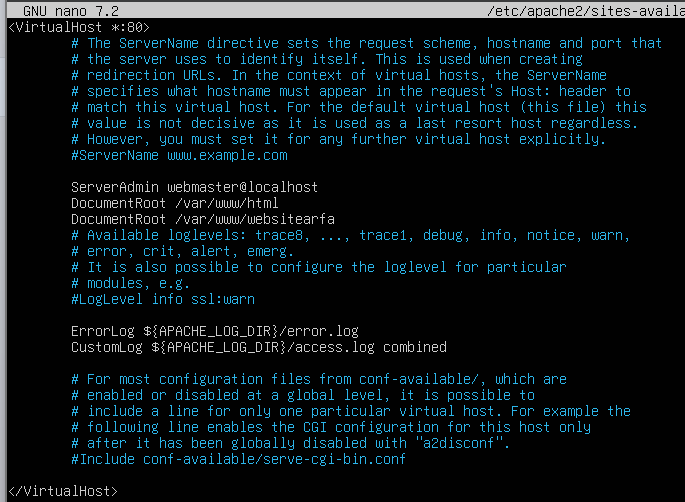 |
| Restart Apache | 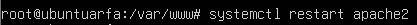 |
| `mkdir about` |  |
| Buat `about/index.html` |  |
| Isi `about/index.html` | 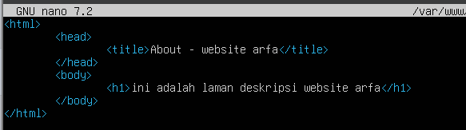 |

### Pengujian

| Uji | Bukti |
|-----|-------|
| Virtual host lewat `w3m` | 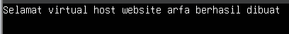 |
| Sub folder `/about` lewat `w3m` | 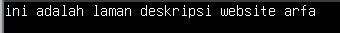 |
| Akses dari browser Windows | 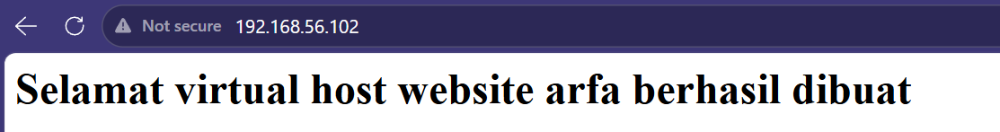 |
