# Samba Server

## 1. Overview

Samba adalah perangkat lunak open source yang mengimplementasikan protokol SMB/CIFS, sehingga server Linux dapat berbagi file dengan klien Windows. Praktikum ini memasang Samba di Ubuntu Server, membuat dua folder berbagi (`share1` dan `share2`) dengan hak akses berbeda untuk dua user (`user1` dan `user2`), lalu mengujinya dari klien Windows.

## 2. Lab Environment

* OS: Ubuntu Server
* Virtualization: Oracle VirtualBox
* Hostname server: `ubuntuarfa`
* IP server (host-only, interface `enp0s8`): `192.168.56.102`
* Klien: Windows (File Explorer dan CMD)

## 3. Installation

1. Masuk sebagai root.

   ```bash
   sudo -i
   ```

2. Update paket.

   ```bash
   apt update
   ```

3. Pasang Samba (butuh koneksi internet).

   ```bash
   apt install samba
   ```

4. Cek status layanan. Hasil yang diharapkan: `active (running)`.

   ```bash
   systemctl status smbd
   ```

5. Cek firewall, aktifkan jika belum aktif, lalu izinkan Samba.

   ```bash
   ufw status
   ufw enable
   ufw allow Samba
   ```

## 4. Configuration

**a. Buat direktori dan file uji**

```bash
mkdir /home/share1
mkdir /home/share2
touch /home/share1/testfile1.txt
touch /home/share2/testfile2.txt
```

**b. Buka hak akses level OS.** Pembatasan akses sepenuhnya diatur oleh konfigurasi Samba.

```bash
chmod 777 /home/share1
chmod 777 /home/share2
```

**c. Buat user sistem**

```bash
useradd user1
useradd user2
```

**d. Daftarkan user ke database Samba** (masukkan password dua kali untuk tiap user)

```bash
smbpasswd -a user1
smbpasswd -a user2
```

**e. Edit `/etc/samba/smb.conf`**

```bash
nano /etc/samba/smb.conf
```

Tambahkan di bagian paling bawah file:

```ini
[share1]
path = /home/share1
valid users = user1, user2
read list = user2
write list = user1
browseable = yes

[share2]
path = /home/share2
valid users = user1, user2
read list = user1
write list = user2
browseable = yes
```

Simpan dengan `Ctrl+X`, `Y`, lalu `Enter`.

Ringkasan hak akses:

| Share | Path | Read only | Read + Write |
|-------|------|-----------|--------------|
| `share1` | `/home/share1` | `user2` | `user1` |
| `share2` | `/home/share2` | `user1` | `user2` |

**f. Restart layanan agar konfigurasi diterapkan**

```bash
systemctl restart smbd
```

## 5. Testing

1. Cek IP Ubuntu Server dari terminal server.

   ```bash
   ip a
   ```

2. Di Windows, buka File Explorer dan ketik alamat server di address bar:

   ```
   \\192.168.56.102
   ```

   Folder `share1` dan `share2` harus muncul.

3. Buka `share1`, lalu login sebagai `user1`. Cek tiga hal: melihat isi folder, membuat file baru, dan menyalin file ke penyimpanan lokal Windows.

4. Masih login sebagai `user1`, ulangi pengecekan yang sama di `share2`.

5. Putuskan koneksi Samba lewat CMD Windows.

   ```cmd
   net use
   net use \\192.168.56.102\share1 /delete
   ```

   Ganti nama koneksi sesuai hasil `net use`.

6. Login sebagai `user2`, lalu ulangi pengecekan di `share1` dan `share2`.

**Hasil pengujian**

| User | Direktori | Hak akses Samba | Melihat isi | Menyalin file | Membuat file baru |
|------|-----------|-----------------|-------------|---------------|-------------------|
| user1 | share1 | Write list | Ya | Ya | Ya |
| user1 | share2 | Read list | Ya | Ya | Tidak (*Access Denied*) |
| user2 | share1 | Read list | Ya | Ya | Tidak (*Access Denied*) |
| user2 | share2 | Write list | Ya | Ya | Ya |

Hasil ini sesuai konfigurasi. Pembuatan file ditolak (*Destination Folder Access Denied*) pada share yang hanya punya hak baca.

## 6. Troubleshooting

Tidak ada kendala yang tercatat selama praktikum. Panduan di laporan jika layanan Samba tidak berjalan:

* **Gejala:** `systemctl status smbd` menampilkan `inactive (dead)`.
* **Penyelesaian:**
  1. Jalankan layanan secara manual.

     ```bash
     service smbd start
     ```

  2. Cek lagi dengan `systemctl status smbd`.
  3. Jika masih gagal, pasang ulang Samba dengan `apt install --reinstall samba`.

Catatan lain:

* Jika folder share tidak muncul di Windows, pastikan firewall mengizinkan Samba (`ufw allow Samba`) dan IP yang dipakai sudah benar.
* *Access Denied* saat membuat file di share dengan hak baca saja adalah perilaku yang diharapkan, bukan error.

## 7. Screenshots

### Instalasi

| Langkah | Bukti |
|---------|-------|
| Login root | 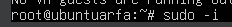 |
| `apt update` | 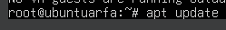 |
| `apt install samba` | 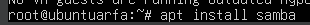 |
| Status `smbd` aktif | 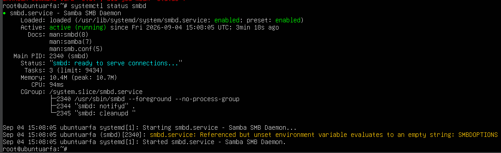 |
| Status `smbd` inactive (contoh jika gagal) | 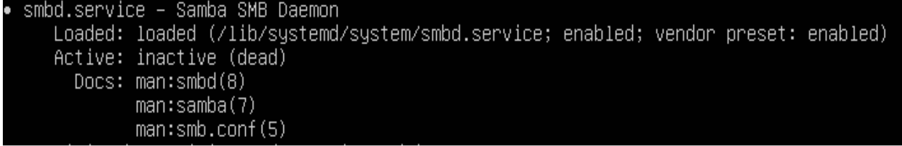 |
| Firewall `ufw status` dan `ufw enable` | 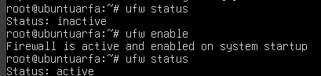 |
| `ufw allow Samba` | 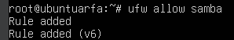 |

### Konfigurasi

| Langkah | Bukti |
|---------|-------|
| Buat direktori | 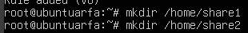 |
| Buat file uji | 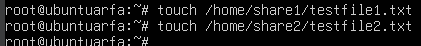 |
| `chmod 777` | 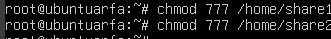 |
| Buat user | 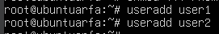 |
| Password Samba | 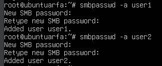 |
| Isi `smb.conf` | 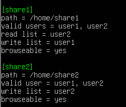 |
| Restart `smbd` | 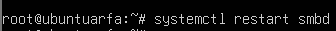 |

### Pengujian

**Persiapan**

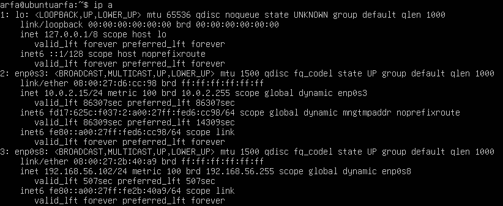
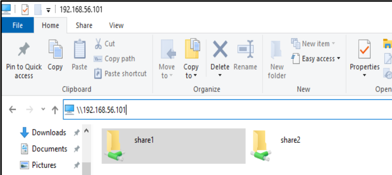
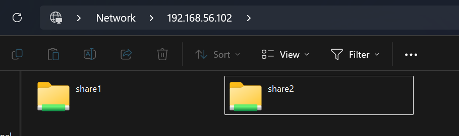

**user1**

| Uji | Bukti |
|-----|-------|
| Login `user1` | 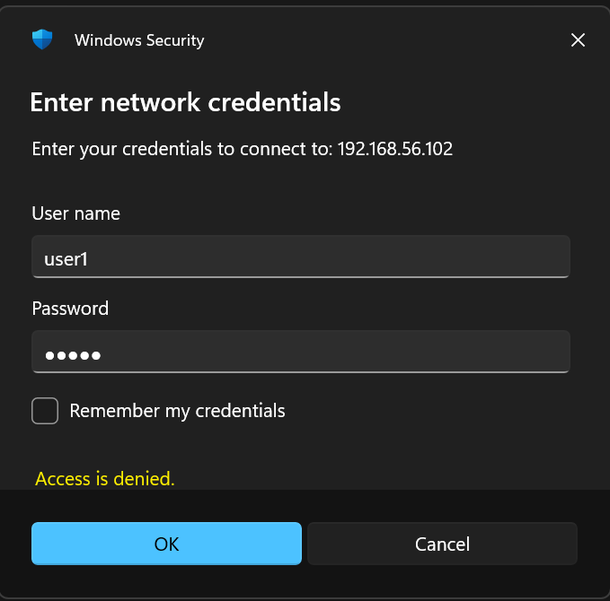 |
| `share1`: lihat isi | 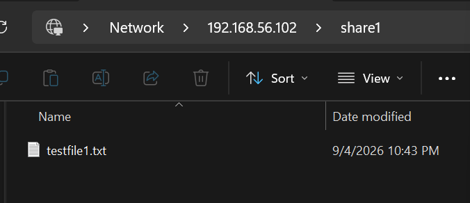 |
| `share1`: buat file | 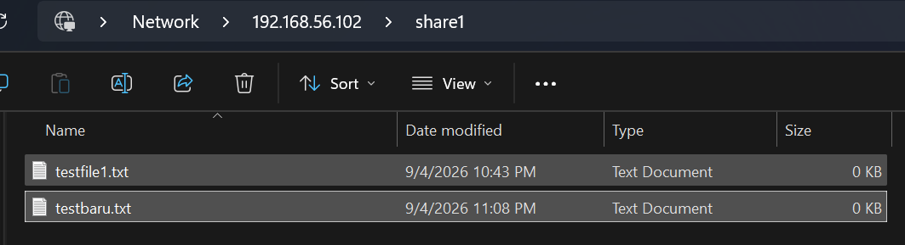 |
| `share1`: salin file | 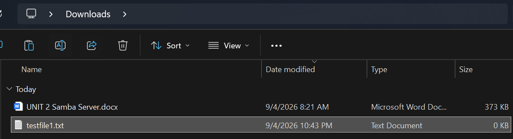 |
| `share2`: lihat isi | 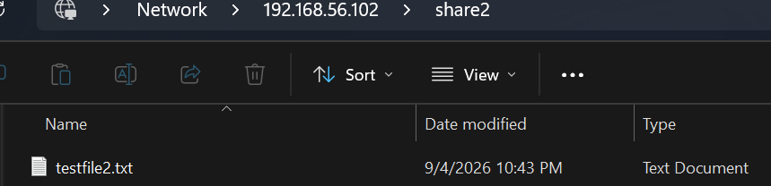 |
| `share2`: buat file (ditolak) | 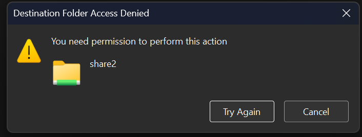 |
| `share2`: salin file | 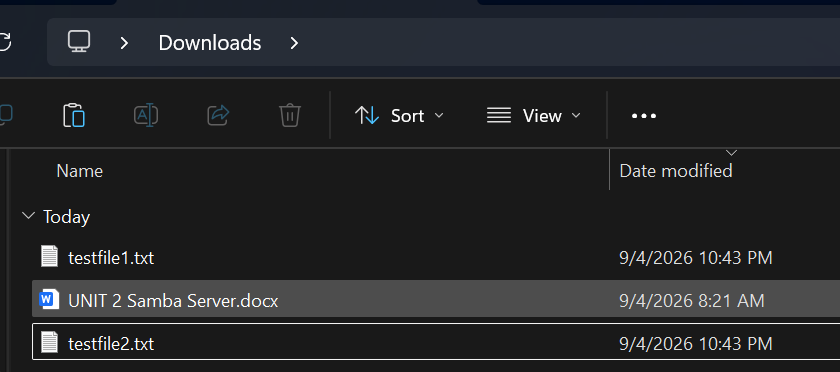 |

**Putuskan koneksi**

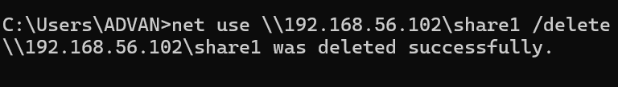

**user2**

| Uji | Bukti |
|-----|-------|
| Login `user2` | 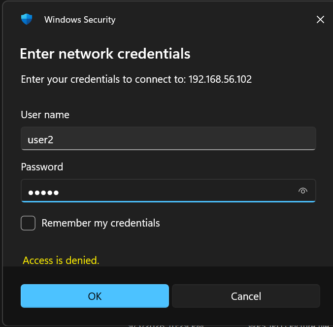 |
| `share1`: lihat isi | 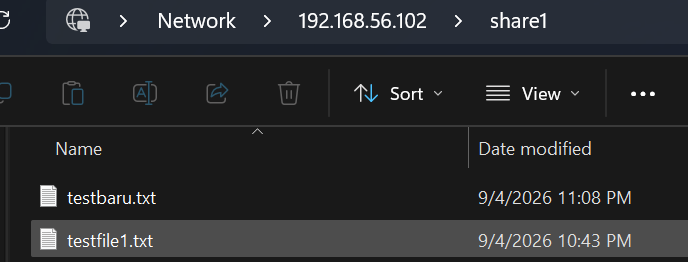 |
| `share1`: buat file (ditolak) | 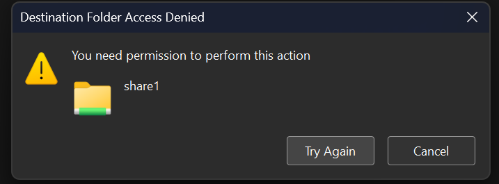 |
| `share1`: salin file | 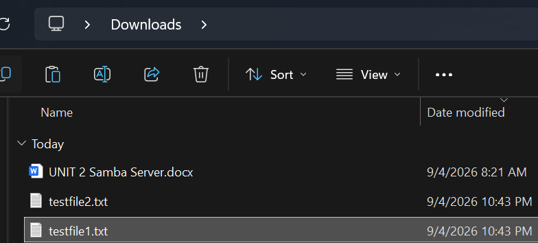 |
| `share2`: lihat isi | 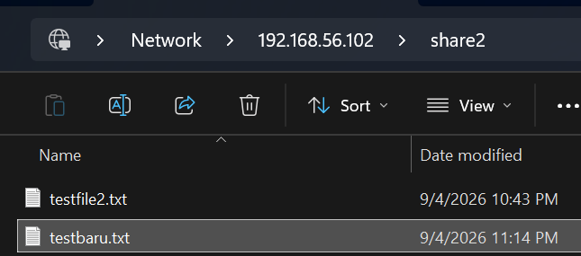 |
| `share2`: buat file | 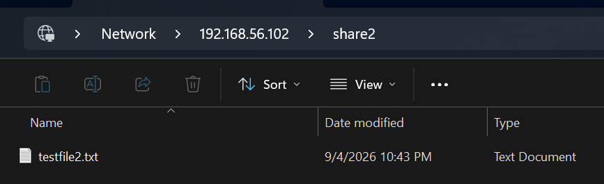 |
| `share2`: salin file | 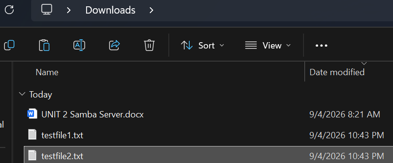 |
